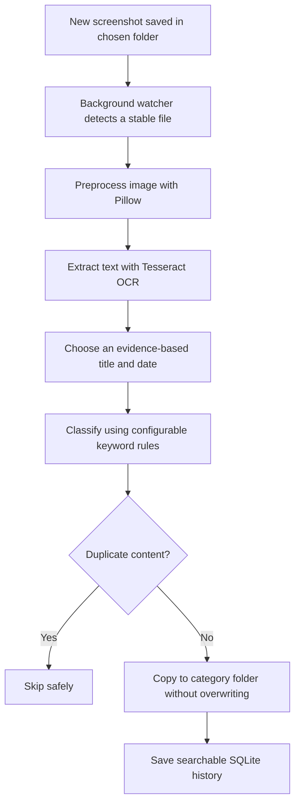

<div align="center">

# 📸 Smart Screenshot Organizer

### From `Screenshot (42).png` to a searchable, organized screenshot library — automatically.

**A privacy-first Windows screenshot organizer powered by OCR, rule-based classification, and background automation.**


**🔒 Local processing** · **📋 Copy-only background mode** · **🔎 Searchable history** · **⚡ Zero-click after setup**

</div>

---
## 🤝 Contributions Welcome!

Smart Screenshot Organizer is open-source and welcomes contributions
from developers of all experience levels!

Whether you're a beginner exploring your first GitHub contribution
or an experienced Python developer, we'd love your help.

### 🚀 Start Contributing

- 🐛 [Report a Bug](https://github.com/Iqranawaz-debug/Screenshot_Organizer/issues/new/choose)
- 💡 [Suggest a Feature](https://github.com/Iqranawaz-debug/Screenshot_Organizer/issues/new/choose)
- 🌱 [Explore Good First Issues](https://github.com/Iqranawaz-debug/Screenshot_Organizer/labels/good%20first%20issue)
- 🛠️ [Find Help Wanted Issues](https://github.com/Iqranawaz-debug/Screenshot_Organizer/labels/help%20wanted)
- 📖 [Read Contribution Guidelines](CONTRIBUTING.md)

### ⭐ Featured Contribution Opportunities

| Issue | Area | Level |
|---|---|---|
| [#2 - Improve Windows Installation Documentation](https://github.com/Iqranawaz-debug/Screenshot_Organizer/issues/2) | Documentation | Beginner |
| [#3 - Improve Screenshot Categorization Tests](https://github.com/Iqranawaz-debug/Screenshot_Organizer/issues/3) | Python Testing | Beginner-Friendly |

**How to contribute:**

1. Choose an open issue.
2. Comment that you'd like to work on it.
3. Follow the instructions in `CONTRIBUTING.md`.
4. Fork the repository and make your changes.
5. Submit a pull request for maintainer review.

All contributions are reviewed to preserve the project's
privacy, security, and existing functionality.

**Maintained by [Iqra Nawaz](https://github.com/Iqranawaz-debug).**

---
## 🌟 The idea

Tired of a Screenshots folder full of files named `Screenshot (42).png`, `Screenshot (43).png`, and `Screenshot (44).png`?

**Smart Screenshot Organizer** watches a screenshot folder, extracts text from each saved image using Tesseract OCR, picks a meaningful title from *visible evidence*, adds the file date, and creates an organized copy in the right category. It also stores a **searchable, local SQLite history**, so you can find older screenshots by their content.

No paid API, cloud upload, or large language model is required. **This is OCR + explainable rules, not generative AI.**

### ✨ Before → After

```text
📁 Screenshots/                         📁 organized_screenshots/
├── Screenshot (42).png                 ├── Programming/
└── Screenshot (43).png                 │   └── Python_Exception_Handling_2026-10-17.png
                                        └── Education/
                                            └── Database_Management_Systems_Assignment_02_2026-10-17.png
```

> **Your originals stay untouched** when you use automatic background mode. The destination receives a new copy, and duplicate content is skipped.

## 🧠 How it works



### 🧩 Technology stack

| Layer | Technology | Job |
|---|---|---|
| Language | Python | Application logic and automation |
| OCR | Tesseract + pytesseract | Extract visible screenshot text |
| Image processing | Pillow | Resize, enhance, and prepare images for OCR |
| File monitoring | watchdog | Detect new screenshot files |
| Storage | SQLite | Local processing history and search |
| Dashboard | Streamlit | Optional preview, history, settings, and search |
| Automation | PowerShell + Windows Task Scheduler | Quiet startup and optional launch on sign-in |
| Testing | pytest | Automated unit and integration checks |

## 📷 Project showcase

*Add your own screenshots later: a before/after folder view, the optional Streamlit dashboard, background status, and the History & Search tab. Avoid publishing personal screenshots or OCR text.*

| View | What to show |
|---|---|
| 🗂️ Before & after | Original Screenshots folder beside categorized output |
| 🖥️ Dashboard | Optional Streamlit management interface |
| 🔎 Search | A query finding a screenshot using its OCR text |
| ⚙️ Background status | `background.py status` showing active copy mode |

## ⚡ Quick start — automatic screenshot organization

After installing **Python dependencies and Tesseract** (see [Installation](#-installation-windows-vs-code-terminal)), run these commands **from the project folder**:

```powershell
.\.venv\Scripts\python.exe background.py configure
.\scripts\Start-Automation.ps1
.\.venv\Scripts\python.exe background.py status
```

✅ Save new screenshots to the configured folder. The organizer processes them in the background — **no browser, dashboard, or manual approval required**. The initial run leaves pre-existing screenshots alone unless you choose `--process-existing`.

For control over each file, use [manual preview and organization](#-manual-processing-and-sample-quick-start) or the [optional Streamlit dashboard](#%EF%B8%8F-optional-dashboard).

### 🧭 Contents

- [Automatic background processing](#-set-up-zero-click-background-processing)
- [Features](#-features)
- [Safety guarantees](#-safety-guarantees)
- [Project structure](#%EF%B8%8F-project-structure)
- [Requirements and installation](#-installation-windows-vs-code-terminal)
- [Manual CLI and dashboard](#-manual-processing-and-sample-quick-start)
- [Privacy, tests, and troubleshooting](#%EF%B8%8F-database-and-privacy)
- [Known limitations](#%EF%B8%8F-known-limitations)

---

## 🔄 Set up zero-click background processing

Run these commands from the project folder after installing dependencies and Tesseract:

```powershell
.\.venv\Scripts\python.exe background.py configure
.\scripts\Start-Automation.ps1
.\.venv\Scripts\python.exe background.py status
```

`configure` asks Windows for the Screenshots known folder, falling back to the actual Pictures known folder
plus `Screenshots`. This honors Windows/OneDrive folder redirection without guessing a username. It saves
local settings in ignored `automation.json`; it does not start processing. To override the source or output:

```powershell
.\.venv\Scripts\python.exe background.py configure --source "D:\Screenshots" --dest "D:\Organized"
```

Use a dedicated screenshot folder. Background automation accepts all supported image filenames in that folder,
including localized Windows names. It never scans subfolders. Source and destination cannot be equal or nested.
Existing screenshots are excluded on the first start unless you configure with `--process-existing`.
After the first start, a local checkpoint lets restarts recover images saved while automation was stopped.
Changes to configuration take effect after stopping and restarting the service. If the source is missing or
Tesseract is unavailable, status says `waiting` and the service retries. It never creates the Windows source folder.

The quiet launcher uses the project's `pythonw.exe`; no console or browser is needed. Expect status
`active: true`, `state: running`, and `mode: copy`. Closing the terminal or Streamlit does not stop automation.
A source-folder lock prevents simultaneous CLI/dashboard/background watchers within this installation;
an OS-backed background lock also rejects duplicate service launches and is released after a crash.

### Start at Windows login (optional, explicit installation)

**The startup task is not installed by creating these files. Run Install only when you choose to enable it.**

```powershell
.\scripts\Startup-Automation.ps1 -Action Install
.\scripts\Startup-Automation.ps1 -Action Verify
```

This registers `Smart Screenshot Organizer` for the current user's interactive login, with a 30-second delay,
normal privileges, no password storage, no execution time limit, battery operation allowed, duplicate task
instances ignored, and up to three restarts one minute apart after a failure. It starts on the next login;
use `Start-Automation.ps1` to start now. Organization always copies: no automatic move/delete mode exists here.
If organizational policy denies task registration, contact the machine administrator rather than running the
organizer permanently with elevated privileges. If the project/venv is moved, uninstall and reinstall the task.

```powershell
# Stop this run; the installed task will still start at the next login.
.\scripts\Stop-Automation.ps1

# Disable future login starts and gracefully stop the current run.
.\scripts\Startup-Automation.ps1 -Action Disable

# Remove the login task, retaining configuration, screenshots and history.
.\scripts\Startup-Automation.ps1 -Action Uninstall
```

After Disable, use Uninstall then Install to enable login startup again. Do not use Task Scheduler's forced
End action for routine shutdown: Stop-Automation lets the current copy/history write finish. OCR has a 60-second
timeout. If shutdown exceeds 90 seconds, the stop command reports it without forcibly killing processing.
A severely stalled disk operation may still delay shutdown.

If PowerShell blocks a script, you can invoke it once with
`powershell -NoProfile -ExecutionPolicy Bypass -File .\scripts\Start-Automation.ps1` rather than changing your
machine-wide policy. Scripts locate the project relative to themselves, including paths with spaces.

### Win + Shift + S and clipboard images

For Snipping Tool versions that support automatic saving, turn on automatic screenshot saving in its Settings
and use the same folder configured above. Then **Win + Shift + S** feeds the same zero-click file pipeline.
If Snipping Tool uses a custom save folder, configure that folder explicitly. **Win + PrtScn** is another
file-saving workflow. [Microsoft's Snipping Tool instructions](https://support.microsoft.com/en-au/windows/apps/use-snipping-tool-to-capture-screenshots)
explain the automatic save setting and folder selection.

Clipboard-only captures are **not collected**. A generic clipboard image does not reliably prove that it came
from a screenshot; polling it could capture copied photos or private unrelated content. No clipboard contents
are read, changed, or cleared by this application. On versions without automatic saving, use a file-saving
screenshot shortcut or save the snip to the watched folder. Direct clipboard capture would need an explicit,
separately enabled capture workflow rather than silently monitoring every clipboard image.

### Verify the complete pipeline

1. Start automation and confirm `state: running`.
2. Take a screenshot containing a clear heading such as `Python Exception Handling`.
3. Within a few seconds, expect a new file under
   `organized_screenshots/Programming/Python_Exception_Handling_YYYY-MM-DD.png` (OCR/date depend on the image).
4. Confirm the original still exists and run `python main.py history` and `python main.py search exception`.
5. Copy the same screenshot into the source under another image name. The duplicate should be skipped, with
   no additional destination copy or saved history row.
6. Run Start-Automation again: it should report that automation is already active.
7. Stop, take another screenshot, restart: the new image should be recovered using the checkpoint.
8. After explicitly installing startup, sign out and back in, wait about 30 seconds, then run Verify.

The worker waits for stable, readable files and retries unfinished/failed arrivals during a 30-second
reconciliation pass. It reuses the existing OCR, rule-based naming, date, categories, hash cache, exclusive-create
copy, and SQLite history. Low-confidence OCR uses a neutral filename. Check these local files for diagnostics:

- `runtime/automation.log` (rotated, three backups): processing and exceptions.
- `runtime/launcher-error.log`: quiet-launch errors.
- `runtime/status.json`: current state and latest startup error; use the status command to verify the live lock.
- `runtime/seen.json`: restart checkpoint, containing file paths and size/mtime signatures.
- `data/screenshots.db`: searchable full OCR history.

`runtime/` and `automation.json` are ignored by Git and may contain private paths. No screenshots or OCR text are
sent to a service. Keep the existing privacy cautions below, including the OCR library's OS temporary files.
The optional dashboard shows background status, supports saving source/output configuration while stopped,
and retains history/search and manual processing. Its separate watcher controls are optional.

## ✨ Features

| Area | What it does |
|---|---|
| Detection | Scans only the folder you choose; configurable filename patterns (`Screenshot*`, `Snip*`, ...); hand-pick any image; PNG, JPG, JPEG, WebP |
| OCR | Tesseract via `pytesseract`, with Pillow preprocessing (grayscale, dark-theme inversion, upscaling, contrast) |
| Titles | Rule-based: removes UI noise (clocks, URLs, menus), prefers the most prominent heading, never invents words, neutral `Screenshot` fallback when OCR is unreliable |
| Dates | `YYYY-MM-DD` from EXIF original capture time, then EXIF `DateTime`, then file modified time; the source is recorded; dates printed inside the image are never used |
| Categories | `Education`, `Work`, `Programming`, `Personal`, `Uncategorized` from configurable keyword rules; weak or ambiguous evidence goes to `Uncategorized` |
| Monitoring | `watchdog` watches a folder for new screenshots, waits until the file is fully written, deduplicates pending events and skips duplicate content on real runs |
| History | SQLite database with OCR text, titles, dates, categories and status; multi-word text search |
| Dashboard | Streamlit app: preview, OCR text, approve before copying, watcher controls, history and search |

## 🔒 Safety guarantees

- **Manual commands use dry run by default.** Background automation automatically copies after you explicitly start it. Manual screenshot files change only with `--apply` (CLI), **Apply approved items** (dashboard), or **Start watcher** with dry run unchecked. CLI commands can create `logs/app.log` even during previews.
- **Copy by default.** Moving needs `--mode move` **and** typing `MOVE` (dashboard: a checkbox and typing `MOVE`).
- **Never overwrites** an existing file (`_02`, `_03` suffixes). Confirmed moves remove originals after a successful copy and size check; failed copies may remove only the partial output they just created.
- **Duplicates are skipped** by content hash, so re-running never creates copies.
- Source and destination folders may not be the same or nested inside each other; already-organized files are never re-processed.
- File read/copy failures are generally reported per file; missing Tesseract stops processing. Unreadable image content can produce a neutral filename. Unexpected errors or database failures can still interrupt a CLI batch.
- The scanner never walks your whole computer, only folders you give it.

## 🗂️ Project structure

```text
smart_screenshot_organizer/
├── background.py           Standalone automatic copy service
├── scripts/                Quiet start/stop and optional login task
├── app.py                  Optional Streamlit dashboard
├── main.py                 Command-line interface
├── config.py               All settings and category rules
├── make_sample_images.py   Creates two fake screenshots for testing
├── requirements.txt
├── pytest.ini
├── src/
│   ├── models.py             Shared dataclasses
│   ├── image_processor.py    Pillow preprocessing
│   ├── ocr_engine.py         Tesseract wrapper (line-level results)
│   ├── text_analyzer.py      Noise removal, heading and keyword scoring
│   ├── title_generators.py   TitleGenerator interface (LLM-ready)
│   ├── date_resolver.py      Capture-date logic
│   ├── filename_generator.py Safe Windows filenames, collisions
│   ├── screenshot_detector.py Folder scanning, patterns
│   ├── categorizer.py        Rule-based categories
│   ├── duplicate_detector.py Content-hash duplicate detection
│   ├── organizer.py          Plan and apply (dry-run, copy, move)
│   ├── folder_watcher.py     watchdog monitoring
│   ├── metadata_store.py     SQLite history and search
│   └── services.py           Logic behind the dashboard
├── tests/
├── sample_images/
├── organized_screenshots/    (created when you apply)
├── data/                     (SQLite database, created when you apply)
└── logs/                     (app.log)
```

## 🧰 Requirements

- Windows 10/11, Python 3.12+ (developed and tested on 3.14; other versions not verified here); VS Code is optional
- [Tesseract OCR](https://github.com/UB-Mannheim/tesseract/wiki) (free)
- Python packages: `Pillow`, `pytesseract`, `watchdog`, `streamlit`, `pytest`

## 🚀 Installation (Windows, VS Code terminal)

**1. Install Tesseract.** Download the installer from the UB Mannheim page above, keep the default folder
(`C:\Program Files\Tesseract-OCR`) and make sure **English** is selected. The app finds that default path automatically.
If you install elsewhere, set `tesseract_cmd` in `config.py`.

**2. Get the project and create a virtual environment.**

Choose a local folder you can write to, outside your OneDrive folder, such as
`C:\dev\smart_screenshot_organizer`. Create the parent folder if needed, then clone
or extract the project there. In VS Code, open that project folder and its terminal.
Replace `path\to\smart_screenshot_organizer` below with your actual project path.

**Check the location first:** open the project folder in File Explorer and click
the address bar to see its full path. Typical OneDrive paths include
`C:\Users\<your-name>\OneDrive\...` or `OneDrive - <organization>\...`.
Desktop and Documents can also be backed up by OneDrive, so check their actual
location rather than relying on the folder name. OneDrive cloud, sync-arrow or
green-check status icons are another clue; a green check means local availability,
not that the folder is outside OneDrive.

```powershell
cd path\to\smart_screenshot_organizer
python -m venv .venv
.\.venv\Scripts\Activate.ps1
python -m pip install -r requirements.txt
```

If PowerShell blocks activation: `Set-ExecutionPolicy -Scope CurrentUser RemoteSigned`, then try again.

> 💡 Keep the **project files and virtual environment outside OneDrive-synced folders**.
> The app writes local database, log and runtime files while it runs. Syncing adds
> another process accessing those files, and online-only files need downloading
> before use. Keeping the project local avoids these extra sync and availability
> problems; it does not fix every permission or database-lock error.
> See Microsoft's [OneDrive file-in-use guidance](https://support.microsoft.com/en-us/onedrive/troubleshoot-onedrive-error-this-file-can-t-be-synced)
> and [status icon explanations](https://support.microsoft.com/en-gb/onedrive/what-do-the-onedrive-icons-mean).
> This recommendation concerns the installation folder; screenshot-folder
> detection still honors Windows/OneDrive redirection as described above.

**3. Verify.**

```powershell
python main.py check
python -m pytest -q
```

## ⚡ Manual processing and sample quick start

```powershell
python make_sample_images.py                       # creates 2 fake screenshots in sample_images\
python main.py preview sample_images --show-candidates
python main.py organize --source sample_images     # DRY RUN: shows the plan, changes nothing
python main.py organize --source sample_images --apply
python main.py history
python main.py search exception
```

## 💻 Command reference

| Command | Purpose |
|---|---|
| `python main.py check` | Verify Tesseract and the English language data |
| `python main.py ocr <image>` | Print the OCR text and confidence of one image |
| `python main.py preview <image-or-folder> [--show-candidates]` | Show proposed filenames; changes nothing |
| `python main.py organize [--source DIR] [--dest DIR] [--files IMG ...] [--recursive] [--all-images] [--mode copy\|move] [--apply]` | Plan (default) or apply organization |
| `python main.py watch --source DIR [--dest DIR] [--all-images] [--mode copy\|move] [--apply]` | Monitor a folder for new screenshots (Ctrl+C to stop) |
| `python main.py history [--limit N] [--details]` | Recently processed screenshots; optional saved filenames, destination, title, category and status |
| `python main.py search WORD [WORD ...] [--category NAME] [--limit N]` | All words must match across OCR text, title, filenames or category |

Useful flags: `--all-images` ignores the filename patterns; `--files` accepts any image regardless of its name;
`--dest` defaults to `organized_screenshots\` in the project folder. `organize` requires `--source` and/or `--files`.
Both `history` and `search` default to `--limit 20`.

Use `python main.py history --details` to inspect saved processing results. Details do not
reprocess images or update historical categories. Category reasoning is available during
processing but is not stored in the current database schema.

### Finding your Windows screenshots folder

```powershell
$shots = Join-Path ([Environment]::GetFolderPath('MyPictures')) 'Screenshots'
Test-Path $shots        # False? Press Win+PrtScn once; Windows creates the folder
python main.py watch --source $shots --dest watch_out          # dry run first
```

## 🖥️ Optional dashboard

```powershell
streamlit run app.py
```

1. **Organize tab:** choose folders in the sidebar, click **Scan & preview**, inspect each OCR text, untick anything
   you do not want, then **Apply approved items**.
2. **Watcher tab:** start or stop monitoring. It starts in dry-run mode and is copy-only.
3. **History & Search tab:** browse the 50 most recent saved outcomes or search up to 50 matches. Dry runs and skipped duplicates are not saved.

If port 8501 is busy: `streamlit run app.py --server.port 8599`.

## ⚙️ Configuration (`config.py`)

| Setting | Meaning |
|---|---|
| `supported_extensions` | Image types that are processed |
| `screenshot_name_patterns` | Filename globs treated as screenshots |
| `default_destination` | Where organized files go |
| `database_path` | SQLite file (default `data/screenshots.db`) |
| `categories` / `CATEGORY_RULES` | Keyword weights per category |
| `category_min_score`, `category_min_margin` | Evidence needed to pick a category |
| `tesseract_cmd`, `ocr_language`, `ocr_psm`, `ocr_min_width` | OCR options |
| `min_text_chars`, `min_mean_confidence`, `min_line_confidence`, `min_title_score` | Reliability gates |
| `max_title_words`, `max_filename_length`, `fallback_title` | Filename rules |

## 🗄️ Database and privacy

History lives in `data/screenshots.db` (SQLite). It stores original and new filenames, paths, the **full OCR text**,
title, date and date source, category, status and a content hash. Dry runs and skipped duplicates are not stored.
The OCR text can contain private information from your screenshots, so `data/` and `logs/` are git-ignored.
**Never publish them, and never commit real screenshots.**

Application outputs stay in the project or configured destinations. `pytesseract` also creates temporary image/text
files in the operating system temp directory and cleans them up; processing is local, but not confined to the project directory.

## 🧪 Testing

```powershell
python -m pytest -q
```

OCR is mocked in unit tests, so they run without Tesseract. Manual test cases:

| # | Action | Expected |
|---|---|---|
| 1 | `organize --source sample_images` (no `--apply`) | Plan printed; no destination or database created; CLI logging may create `logs/` |
| 2 | Same with `--apply` | Files copied into `Programming\` and `Education\`; originals remain |
| 3 | `--apply` again | Both skipped as duplicates; no `_02` files |
| 4 | Copy `Screenshot (42).png` to `holiday.png`, run without `--all-images` | `holiday.png` is not listed |
| 5 | Same with `--all-images` | `holiday.png` is listed |
| 6 | `--dest sample_images\out` | `[error]` about nested folders; nothing changes |
| 7 | `--mode move --apply`, then type anything except `MOVE` | `Cancelled. Nothing was changed.` |
| 8 | `watch` (dry run), then copy an image into the source folder | A `[DRY-RUN]` line after a few seconds |
| 9 | `watch --apply`, copy the same image twice under different names | One `COPIED`, one `SKIPPED (Duplicate...)` |
| 10 | `search python assignment` after the sample run | No results (all words must match one record) |

## 📄 Sample input and output

Screenshot text (heading is the largest text):

```text
Python Exception Handling — Using try and except blocks
try:
    result = 10 / 0
except ZeroDivisionError:
    print('Cannot divide by zero')
```

Illustrative dry-run output (the default destination is printed as an absolute project path; dates depend on file metadata):

```text
=== Screenshot (42).png
  Category     : Programming (Matched: except, exception, print, python)
  Title source : heading
  Date         : 2026-10-17 [file_modified]
  Destination  : organized_screenshots\Programming\Python_Exception_Handling_2026-10-17.png
```

Search output:

```text
1 result(s) for: exception

#1  2026-10-17  [Programming]  Python_Exception_Handling_2026-10-17.png
      Python Exception Handling — Using try and except blocks try: result =...
```

## 🩹 Troubleshooting

| Problem | Fix |
|---|---|
| `Tesseract OCR was not found` | Install it, reopen VS Code, run `python main.py check`; or set `tesseract_cmd` in `config.py` |
| Activation blocked in PowerShell | `Set-ExecutionPolicy -Scope CurrentUser RemoteSigned` |
| `ModuleNotFoundError: config` or `src` | Run commands from the project root with the venv active |
| `PermissionError ... pytest-of-<user>` | Already handled by `pytest.ini` (`--basetemp=.pytest_tmp`); delete the stale temp folder if it persists |
| `No screenshots found` | File names do not match the patterns; use `--all-images` or `--files` |
| Title is just `Screenshot` | OCR was unreliable; run `python main.py ocr <image>` and `python main.py preview <image> --show-candidates` |
| Everything lands in `Uncategorized` | Rules are conservative; add keywords in `CATEGORY_RULES` or lower `category_min_score` |
| Watcher prints nothing | Name does not match the patterns (use `--all-images`), file type unsupported, or the file landed before the watcher started |
| `database is locked` | Close other programs using `data\screenshots.db` and avoid OneDrive-synced folders |
| Streamlit will not install on a very new Python | Create a venv with Python 3.12 or 3.13 (`py -3.12 -m venv .venv`) |
| `Pictures\Screenshots` not found | Use the `GetFolderPath('MyPictures')` snippet above and press Win+PrtScn once |

## 🔌 Adding an LLM title generator later

Version 1 uses rules only. Titles come from a `TitleGenerator` (`src/title_generators.py`): an object with a `name`
and `generate(ocr_result, settings) -> TitleAnalysis`. To experiment, write a class with that shape and pass it as
`title_generator=` to `plan_screenshots()` or `build_plan()`. A generator must only use words supported by the OCR text
and return `TitleAnalysis(title=None, source="fallback", ...)` when unsure. Keep the rule-based generator as the
default and implement any rule-based fallback inside your custom generator; there is no automatic retry on generator errors.

## ⚠️ Known limitations

- English OCR by default; other languages require language packs and `ocr_language` configuration. Tiny or low-contrast text can be misread.
- A screenshot with no clear heading may get a body line or a keyword title; the preview exists so you can review it.
- The CLI/dashboard watcher handles new creation and move/rename events only. Background automation also reconciles missed arrivals and resumes from a checkpoint; use `organize` or `--process-existing` for the initial backlog.
- Network drives may not emit file events.

## 🚀 Publishing your own copy to GitHub (Windows)

1. Create an **empty** repository on github.com (no README, no .gitignore, no license yet).
2. From the project folder:

```powershell
git init
git config user.name "Your Name"
git config user.email "you@example.com"
git add .
git status
```

3. **Read the `git status` list.** It must NOT contain `.venv`, `data`, `logs`, `organized_screenshots`, real screenshots,
   or `__pycache__`. Check ignores with `git check-ignore -v data/screenshots.db logs/app.log`.
4. Commit and push (replace the URL with your repository):

```powershell
git commit -m "Initial commit: Smart Screenshot Organizer"
git branch -M main
git remote add origin https://github.com/<your-username>/smart-screenshot-organizer.git
git push -u origin main
```

Sign in through the browser window or Git Credential Manager when asked. Choose a license (for example MIT) and add a
`LICENSE` file before sharing the project publicly.

## 🗺️ Roadmap

Optional LLM title generator behind `TitleGenerator`; extra languages via Tesseract language packs; per-user category
rules in a JSON file; undo log for moves.


## OCR and topic quality

Wide desktop screenshots can still contain tiny text. OCR starts with the configured `ocr_psm` (3 by default),
then retries at larger resolution when confident glyph heights are below `ocr_small_text_height` (16 pixels).
`ocr_retry_scale` defaults to 2, with bounded image size. Sparse/low-confidence results can retry with
`ocr_fallback_psm` (11). All attempts share `ocr_timeout` (60 seconds). Existing grayscale, dark-theme inversion,
Lanczos resizing and autocontrast are reused; no aggressive thresholding or sharpening is applied.

Title selection rejects generic interface labels and obvious character noise, removes numbered step prefixes,
and prefers concise headings. On recognized branded layouts with a separated content column, left navigation
is excluded from title/category evidence. Full OCR text is still retained in history. These are conservative
heuristics, not semantic AI; unusual layouts may still require manual review.

Category keywords and multi-word phrases remain configurable in `CATEGORY_RULES`, with evidence and ambiguity
thresholds in `Settings`. PowerShell, Streamlit and related programming terms are recognized. Mixed evidence
still yields Uncategorized rather than forcing a category. Preview output shows matching category evidence;
the dashboard also shows category and title reasons.

After changing code or configuration, safely restart the standalone worker:

```powershell
.\scripts\Stop-Automation.ps1
.\scripts\Start-Automation.ps1
.\.venv\Scripts\python.exe background.py status
.\.venv\Scripts\python.exe -m pytest -q
```

Existing organized files/history are not renamed by an upgrade. Content duplicates remain skipped. To inspect
an existing image without writing files or history, run `python main.py preview "path\to\image.png" --show-candidates`.
